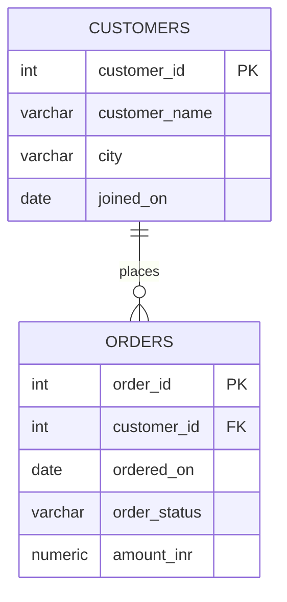

# Conceptual ER Model

## Reading the diagram
- `CUSTOMERS ||` means each order is associated with exactly one customer.
- `o{ ORDERS` means a customer can have zero or many orders.
- `customer_id` is the primary key in `customers` and a foreign key in `orders`.
